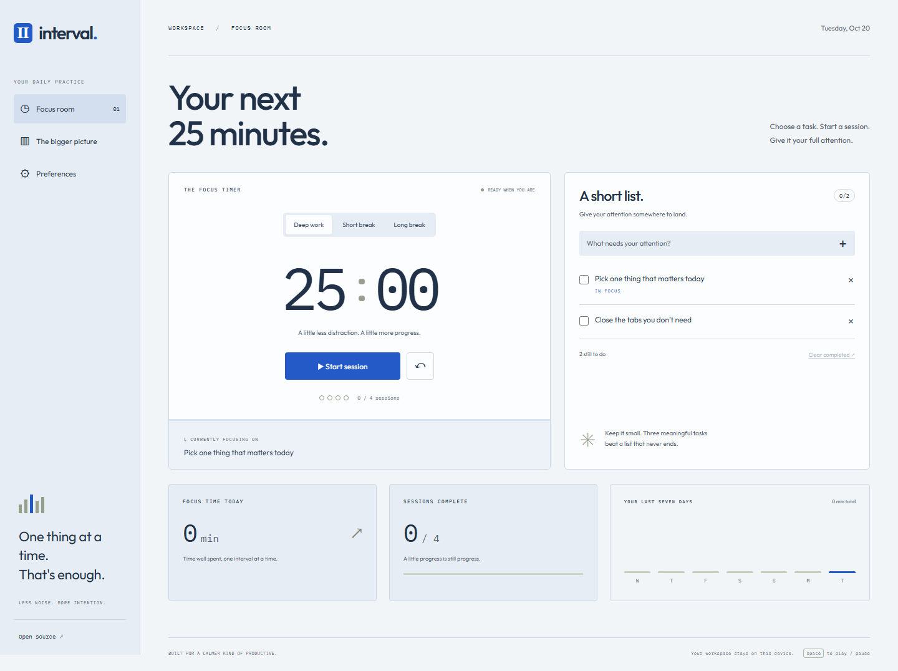

# Interval

A focus timer with a deliberately short task list. Choose what to work on, start a session, and see how the minutes add up across the week.

[Live demo](https://goshkaaaa.github.io/interval/) · [Mobile preview](docs/mobile.png) · [Checks](https://github.com/goshkaaaa/interval/actions)



## What it does

- Start, pause, resume, and reset focus or break sessions.
- Calculate remaining time from an absolute deadline, including after a reload or time in a background tab.
- Prepare a short break after focus, and a long break after every fourth completed focus session in a calendar day.
- Keep the next session paused until you start it.
- Add tasks, choose one to focus on, complete tasks, and clear finished work.
- Adjust session lengths, a daily goal, and an optional completion sound.
- Track completed focus minutes and sessions by local calendar date, with a seven-day chart.

Press Space outside a form control to start or pause. The browser tab title also shows the remaining time. The sample tasks are editable through completion and removal; statistics start at zero.

## Run locally

Use Node.js 24 LTS and npm.

```sh
npm ci
npm run dev
```

Open the local URL printed by Vite.

```sh
npm run lint
npm test
npx playwright install chromium
npm run test:e2e
npm run build
npm run preview
```

Vite produces a static build in `dist/`. The GitHub Pages demo uses `/interval/` as its base path. Verify and Deploy demo workflows are included. The current demo uses a separately published `gh-pages` branch with a locally verified build. Select GitHub Actions as the Pages source to enable automatic deployments when Actions is available.

## Inside

React, JavaScript, Vite, and plain CSS. `src/timer.js` owns deadline arithmetic, input validation, session transitions, local dates, and history restoration. The UI persists meaningful state changes rather than writing to local storage on every tick. A finished session becomes a single history entry; breaks do not count as work.

Unit tests cover late ticks, formatting, session transitions, invalid saved data, and calendar boundaries. Browser tests use a controlled clock to verify pause/resume, reloading, completion, and the absence of automatic break starts. Task persistence, preferences, mobile layout, and initial-screen accessibility are checked too.

## Boundaries

Use one active tab per device. Browser storage is local and does not synchronize simultaneous timers. Clearing site data removes tasks and history. The last 1,000 completed sessions are retained.

Background tabs and sleeping devices can delay sound playback; the deadline still determines the elapsed time when the page resumes. Sound requires browser audio permission and an interaction. Keyboard starts may remain silent until audio has been unlocked with a click. Changing modes or saving preferences resets the timer. Google Fonts have local fallbacks.

MIT license.
